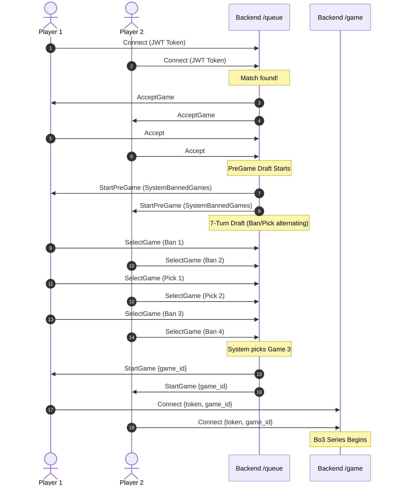

# Cafe Fekr — Realtime Backend Server (`kafehfekrbackend`)

The **realtime game server** for **Cafe Fekr (کافه فکر)**. It orchestrates live multiplayer matchmaking, handles client connections via Socket.IO, drives turn timers and disconnections, executes authoritative game rules for 20+ board games, calculates match rewards, and hosts simulated AI bots.

---

## 1. High-Level Summary

| Property | Value |
|---|---|
| **Primary Stack** | Python 3.12, `python-socketio` (ASGI), `FastAPI` (Healthcheck), `uvicorn`, `pymongo` |
| **Default Port** | `5000` (`PORT=5000`, `HOST=0.0.0.0`) |
| **Protocol** | WebSockets / HTTP Long-Polling (Socket.IO v4, `EIO=4`) |
| **Database** | MongoDB (`KafehFekrDB`) |
| **Companion REST Service** | `kafehfekrserver` (Port `5001`) |
| **Client Applications** | Godot 4.7 (`cafefekr/`), Legacy Flutter (`flutter-code/`) |

---

## 2. System Architecture

The backend operates on an event-driven, authoritative three-layer model:

```
                      +---------------------------------------+
                      |       Client (Godot / Flutter)        |
                      +---------------------------------------+
                                          |
                      Socket.IO v4 (EIO=4, /game, /queue, etc.)
                                          v
                      +---------------------------------------+
                      |         ASGI Application Layer        |
                      |  python-socketio + FastAPI (Health)  |
                      +---------------------------------------+
                                          |
        +---------------------------------+---------------------------------+
        |                                 |                                 |
        v                                 v                                 v
+------------------+             +------------------+             +------------------+
|  Queue & Lobby   |             |   In-Match Game  |             |  In-Process Bots |
|  Controllers     |             |   Orchestrator   |             |  (Classic Rank)  |
|  (/queue,        |             |   (BaseGamePlay) |             |  (ClassicRankBot)|
|   /lobby, etc.)  |             +------------------+             +------------------+
+------------------+                      |
                                          v
                                 +------------------+
                                 |   Game Session   |  <-- TimerClass (AFK, Turns)
                                 |  (BaseGameSession|  <-- Disconnect Recovery (60s)
                                 +------------------+
                                          |
                                          v
                                 +------------------+
                                 | Pure Game Rules  |  <-- Board state, validations,
                                 | (Entities/Games) |      win conditions
                                 +------------------+
                                          |
                                          v
                                 +------------------+
                                 |  Reward Manager  |  <-- Coins, Score, XP,
                                 |  & Database Sync |      MongoDB persistence
                                 +------------------+
```

### The Three-Layer Game Engine

1. **Layer 1: Series Orchestrator (`Controllers/GamePlay/` — `BaseGamePlayClass`)**
   - Manages match series lifecycle (Best-of-3 for Ranked matches, single match for Lobby/Classic).
   - Handles player joining countdown (`Join_Game_Limit_Time = 20s`).
   - Sets user `open_game_id` in MongoDB for match reconnection.
   - Emits series events: `GamePlayData`, `GamePlayNavigate`, and inter-round countdowns (`Game_Play_Round_Time = 10s`).
   - Concludes matches, updates database history records (`game_play_history`), and calculates XP/Coin/Score rewards via `RewardManagerClass`.

2. **Layer 2: Game Session Controller (`Controllers/GameSession/` — `BaseGameSession` & `BaseMultiplayerGameSession`)**
   - Manages individual game rounds and player assignments (`gamer_id: 1..N`).
   - Drives player turn timers via `TimerClass` (`Entities/TimerClass`).
   - **AFK Protection:** Enforces a maximum of 2 missed turns (`check_finish_game_by_not_play_turn()`). After 2 consecutive missed turns, the player forfeits.
   - **Disconnection Tolerance:** Manages 60-second grace timers (`UserDisconnectTimerClass`). Broadcasts `UserDisconnected`, `UserReconnected`, and pauses round timers during disconnection.
   - Delegates gameplay actions to concrete game session implementations (e.g. `chess_game_session.py`, `risk_game_session.py`).

3. **Layer 3: Pure Authoritative Game Rules (`Entities/Games/<Game>/`)**
   - Pure state machines containing board matrices, move validations, and win/draw determinations.
   - Methods:
     - `check_authority(data, gamer_id)`: Validates that the move is permitted for the given gamer.
     - `recieve_data(command_id, data, gamer_id)`: Executes the game command, modifies state, and broadcasts results via `send_data_function`.
     - `get_game_data()`: Serializes current board and round state (used for `ReconnectData`).

---

## 3. Directory Structure

```
kafehfekrbackend/
├── main.py                     # Entry point: ASGI app, Socket.IO server & FastAPI healthcheck
├── Dockerfile                  # Container build definition (Python 3.12-slim)
├── requirements.txt            # Python dependencies
├── .dockerignore / .gitignore   # Ignored files
├── test*.py                    # Test harnesses and smoke scripts
│
├── Bots/                       # In-process AI bots
│   ├── bot_controller.py       # Bot runner and event listener
│   ├── bot_data.py             # Pre-configured bot profile pools (names, avatars)
│   ├── behavior/               # Human-like behaviors (delay heuristics, deliberate mistake rate)
│   │   └── human_behavior.py
│   └── games/                  # Per-game bot decision engines (20+ game scripts)
│
├── Commons/                    # Shared protocol definitions & helpers
│   ├── commands.py             # Master list of ~100 command string constants
│   └── static_functions.py     # Asyncio loop dispatcher (safe_run_async), difficulty mappings
│
├── Controllers/                # Match orchestrators and session managers
│   ├── GamePlay/               # Series-level orchestrator (BaseGamePlayClass)
│   ├── GameSession/            # 20+ game-specific sessions (chess, risk, yatzy, etc.)
│   └── QueueSession/           # Matchmaking queues (rank, lobby, classic_rank, normal)
│
├── Entities/                   # Core business logic and infrastructure
│   ├── Database/               # MongoDB collections & queries
│   ├── Games/                  # Authoritative rules for each game (20 active + 5 legacy/extra)
│   ├── RewardManagerClass/     # XP, Score, and Coin reward calculation algorithms
│   ├── Security/               # JWT token validation & decoding
│   ├── SocketIOClass/          # Socket.IO Namespace handlers (/game, /queue, /lobby, etc.)
│   ├── SocketIOManagerClass/   # Room-level emission helper utilities
│   └── TimerClass/             # Robust threading timer with run_id safety guards
│
├── Models/                     # Data models (Gamer, Queuer, Lobby, User, ChatUser)
└── Temp_Games/                 # Reference prototype scripts
```

---

## 4. Socket.IO Namespaces & Protocols

| Namespace | Handler File | Session Class | Description |
|---|---|---|---|
| `/game` | `Entities/SocketIOClass/game.py` | `BaseGamePlayClass` | Main gameplay room. Handles live moves, reconnects, turn synchronization, and emojis/reactions. |
| `/queue` | `Entities/SocketIOClass/queue.py` | `RankQueueSession` | Ranked matchmaking. Manages queue entry, match acceptance, and 7-turn pick/ban draft. |
| `/classic-rank` | `Entities/SocketIOClass/classic_rank.py` | `ClassicRankSession` | Instant human vs AI bot match generation. Spawns an in-process bot and directs both to `/game`. |
| `/lobby` | `Entities/SocketIOClass/lobby.py` | `LobbySession` | Custom friendly rooms (2–4 players, password support, kick, ready, start). |
| `/multi-queue` | `Entities/SocketIOClass/multi_queue.py` | `MultiRankQueueSession`| 3-player Ludo & Risk queue (Legacy Flutter client). |
| `/chat` | `Entities/SocketIOClass/chat.py` | — | Global community chat (Legacy Flutter client). |

### Wire Protocol

Communication follows a structured command-payload packet format:

- **Client → Server Events**:
  - `user_command`: `{"id": "<CommandId>", "data": <payload>}`
  - `user_reaction`: `{"reactionId": <id>}`
- **Server → Client Events**:
  - `command`: `{"id": "<CommandId>", "data": <payload>}`
  - `reaction`: `{"playerId": <int>, "reactionId": <id>}`

> **Important:** Command IDs are strictly defined in `Commons/commands.py` and must mirror the client registry (`cafefekr/scripts/network/commands.gd`). Legacy spelling conventions such as `SelectPeace`, `PeaceSelected`, and `PeaceSwaped` must not be renamed.

---

## 5. Matchmaking & Pre-Game Pick/Ban Flow

For competitive Ranked Play (`/queue`):



---

## 6. Supported Board Games

The backend includes pure game rule implementations for all active and legacy games:

| Game Type | Persian Title | Players | Turn Time | Rounds | Scoring Type |
|---|---|---|---|---|---|
| `TicTacToe` | تیک تاک تو | 2 | 10s | 5 | Round wins |
| `RPC` | سنگ کاغذ قیچی | 2 | 7s | 3 | Cumulative |
| `FekrBekr` | فکر بکر | 2 | 60s (Setup 60s) | 12 | Guess count |
| `Yatzy` | یاتزی | 2 | 60s | 12 | Cumulative score |
| `FourInRow` | دوز چهارتایی | 2 | 15s | 1 | Single |
| `Chess` | شطرنج | 2 | 20s | 1 | Single |
| `Checkers` | چکرز | 2 | 20s | 1 | Single |
| `BackGammon` | تخته نرد | 2 | 30s | 1 | Cumulative score |
| `Othello` | اتللو | 2 | 20s | 1 | Piece count |
| `Mill` | دوز نه تایی | 2 | 15s | 1 | Single |
| `DotBox` | نقطه خط | 2 | 15s | 1 | Box count |
| `Pentago` | پنتاگو | 2 | 25s | 1 | Single |
| `Yinsh` | یینش | 2 | 30s (Ring 20s) | 1 | Ring points |
| `BattleShip` | نبرد کشتی | 2 | 12s (Setup 60s) | 1 | Hit points |
| `Sudoku` | سودوکو | 2 | 1200s | 1 | Accuracy / Speed |
| `BoxFour` | چهارطرفه | 2 | 12s | 1 | Territory |
| `MNumbers` | کشف اعداد | 2 | 7s | 1 | Pair points |
| `MSweeper` | مین یاب | 2 | 600s | 1 | Mine points |
| `Ludo` | منچ | 2–4 | 25s | 1 | Podium finish |
| `Risk` | ریسک استرایک | 2–4 | 30s (Pass 5s) | 1 | Podium finish |
| *Additional engines:* | `Uno`, `Coup`, `Monopoly`, `Quiz`, `Quoridor` | 2–4 | — | — | Extended library |

---

## 7. Configuration & Environment Variables

| Variable | Default | Purpose |
|---|---|---|
| `PORT` | `5000` | Port for the Socket.IO ASGI server |
| `HOST` | `0.0.0.0` | Host interface binding |
| `MONGO_URI` | `mongodb://localhost:27017/` | Connection string to MongoDB instance |

---

## 8. Development & Deployment

### Running with Docker Compose (Recommended)
From the project root:
```bash
docker compose up -d backend
```

### Running Locally with Python
Ensure dependencies are installed in your virtual environment:
```bash
pip install -r requirements.txt
python main.py
```

### Health Check Endpoints
- **HTTP Healthcheck:** `GET http://localhost:5000/health` -> `{"status": "ok", "service": "backend"}`
- **Socket.IO Polling Handshake:** `GET http://localhost:5000/socket.io/?EIO=4&transport=polling`
