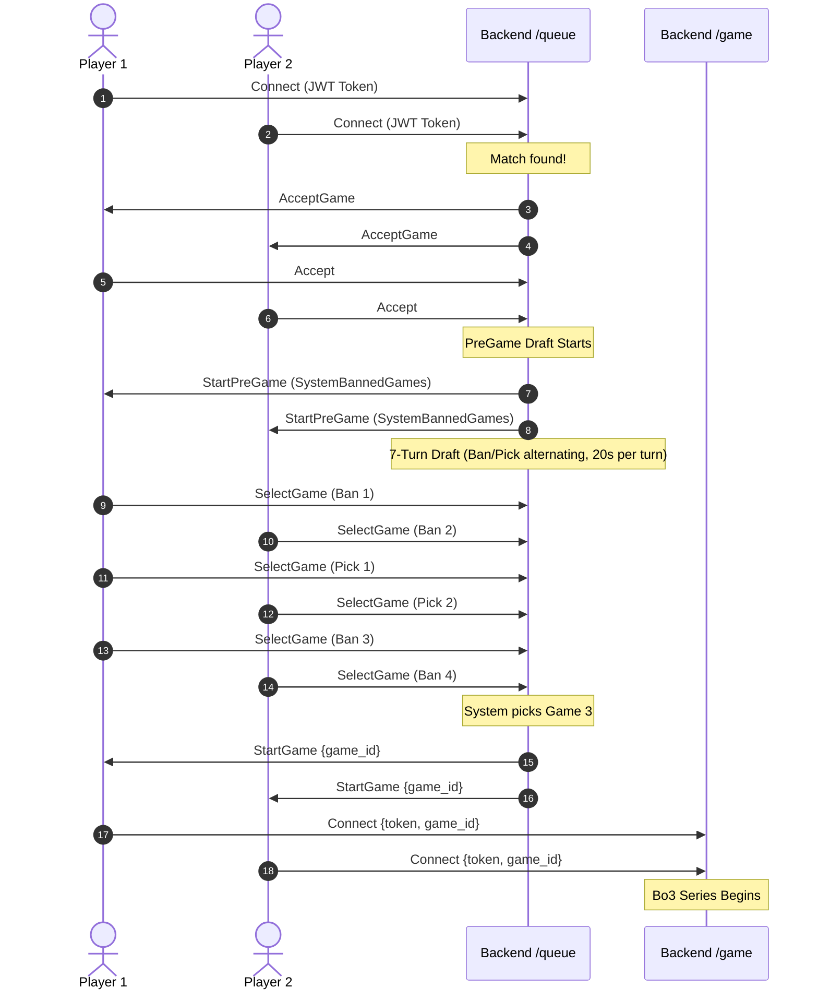

# Cafe Fekr — Realtime Backend Server (`kafehfekrbackend`)

The **authoritative realtime game server** for **Cafe Fekr (کافه فکر)**. It orchestrates live multiplayer matchmaking, handles client connections via Socket.IO, manages turn timers and disconnections, executes authoritative game rules for **25 board games** (including Monopoly, Risk, Chess, Backgammon, Yatzy, and Ludo), calculates competitive Elo rewards, hosts simulated AI bots, and provides real-time social presence, chat, and live game spectating.

---

## 1. High-Level Summary

| Property | Value |
|---|---|
| **Primary Stack** | Python 3.12, `python-socketio` (ASGI), `FastAPI` (Healthcheck & Root route), `uvicorn`, `pymongo`, `nest_asyncio`, `aiohttp` |
| **Default Port** | `5000` (`PORT=5000`, `HOST=0.0.0.0`) |
| **Protocol** | WebSockets / HTTP Long-Polling (Socket.IO v4, `EIO=4`) |
| **Database** | MongoDB (`KafehFekrDB`) |
| **Active Socket Namespaces** | `/game`, `/queue`, `/classic-rank`, `/lobby`, `/social`, `/multi-queue`, `/chat` |
| **Companion REST Service** | `kafehfekrserver` (Port `5001`) |
| **Supported Game Engines** | 25 authoritative board game engines |
| **Client Applications** | Godot 4.7 (`cafefekr/`), Legacy Flutter (`flutter-code/`) |

---

## 2. System Architecture

The backend operates on an event-driven, authoritative three-layer model with real-time social and spectator extensions:

```
                         +---------------------------------------+
                         |       Client (Godot / Flutter)        |
                         +---------------------------------------+
                                             |
                         Socket.IO v4 (EIO=4, /game, /queue, /social, etc.)
                                             v
                         +---------------------------------------+
                         |         ASGI Application Layer        |
                         |  python-socketio + FastAPI (Health)  |
                         +---------------------------------------+
                                             |
         +-----------------------------------+-----------------------------------+
         |                                   |                                   |
         v                                   v                                   v
+------------------+                +------------------+                +------------------+
| Queue & Lobby    |                | In-Match Game    |                | Social & Presence|
| Namespaces       |                | Orchestrator     |                | Namespace        |
| (/queue, /lobby, |                | (BaseGamePlay)   |                | (/social)        |
|  /classic-rank)  |                +------------------+                +------------------+
+------------------+                         |                                   |
         |                                   v                                   v
         v                          +------------------+                +------------------+
+------------------+                |   Game Session   |  <-- TimerClass| Real-time DMs,   |
| In-Process Bots  |                | (BaseGameSession |  <-- 60s DC    | Clan Chat Rooms, |
| (ClassicRankBot, |                +------------------+      Recovery  | Presence Sync,   |
|  25 Game Bots)   |                         |                          | Spectator Snaps  |
+------------------+                         v                          +------------------+
                                    +------------------+                         |
                                    | Pure Game Rules  |  <-- 25 Authoritative   |
                                    | (Entities/Games) |      Game Engines       |
                                    +------------------+                         |
                                             |                                   |
                                             v                                   v
                                    +------------------------------------------------------+
                                    |     Reward Manager & MongoDB Persistence             |
                                    |  (KafehFekrDB: users, history, presence, clans, DMs) |
                                    +------------------------------------------------------+
```

### The Three-Layer Game Engine

1. **Layer 1: Series Orchestrator (`Controllers/GamePlay/` — `BaseGamePlayClass`)**
   - Manages match series lifecycle:
     - **Ranked Series:** Best-of-3 (Bo3) match series across 3 drafted games.
     - **Classic Rank & Lobby:** Single-game matches.
   - Handles player joining countdown (`Join_Game_Limit_Time = 20s`).
   - Sets user `open_game_id` in MongoDB for match reconnection.
   - Emits series events: `GamePlayData`, `GamePlayNavigate`, and inter-round countdowns (`Game_Play_Round_Time = 10s`).
   - Concludes matches, updates database history records (`game_play_history`), and calculates XP/Coin/Score rewards via `RewardManagerClass`.

2. **Layer 2: Game Session Controller (`Controllers/GameSession/` — `BaseGameSession` & `BaseMultiplayerGameSession`)**
   - Manages individual game rounds and player assignments (`gamer_id: 1..N`).
   - Drives player turn timers via `TimerClass` (`Entities/TimerClass`) using thread-safe monotonic `_run_id` guards.
   - **AFK Protection:** Enforces a maximum of 2 missed turns (`check_finish_game_by_not_play_turn()`). After 2 consecutive missed turns, the player forfeits with an AFK penalty.
   - **Disconnection Tolerance:** Manages 60-second grace timers (`UserDisconnectTimerClass`). Broadcasts `UserDisconnected`, `UserReconnected`, and pauses round timers during disconnection.
   - Delegates gameplay actions to 25 concrete game session implementations (e.g. `monopoly_game_session.py`, `chess_game_session.py`, `risk_game_session.py`).

3. **Layer 3: Pure Authoritative Game Rules (`Entities/Games/<Game>/`)**
   - Pure state machines containing board matrices, move validations, and win/draw determinations.
   - Methods:
     - `check_authority(data, gamer_id)`: Validates that the move is permitted for the given gamer.
     - `recieve_data(command_id, data, gamer_id)`: Executes the game command, modifies state, and broadcasts results via `send_data_function`.
     - `get_game_data()`: Serializes current board and round state (used for `ReconnectData` and live spectator sync).
   - Robust payload handling: supports nested `data['data']` and top-level identifiers (e.g. Sudoku piece placements).

---

## 3. Directory Structure

```
kafehfekrbackend/
├── main.py                     # Entry point: ASGI app, Socket.IO server & FastAPI healthcheck
├── Dockerfile                  # Container build definition (Python 3.12-slim)
├── requirements.txt            # Python dependencies (fastapi, python-socketio, pymongo, etc.)
├── .dockerignore / .gitignore   # Ignored files
├── test*.py                    # Test harnesses and smoke scripts
│
├── Bots/                       # In-process AI bots
│   ├── bot_controller.py       # Bot runner and event listener
│   ├── bot_data.py             # Pre-configured bot profile pools (names, avatars)
│   ├── behavior/               # Human-like behaviors (delay heuristics, deliberate mistake rate)
│   │   └── human_behavior.py
│   └── games/                  # Per-game bot decision engines (25 game AI scripts)
│       ├── monopoly.py         # Monopoly AI (property evaluation, auctions, trades)
│       ├── risk.py             # Risk AI (territory threat evaluation, attacks)
│       ├── chess.py            # Minimax Chess AI
│       └── ...                 # 22 additional game bot engines
│
├── Commons/                    # Shared protocol definitions & helpers
│   ├── commands.py             # Master list of ~135 command string constants
│   └── static_functions.py     # Asyncio loop dispatcher (safe_run_async), difficulty mappings
│
├── Controllers/                # Match orchestrators and session managers
│   ├── GamePlay/               # Series-level orchestrator (BaseGamePlayClass)
│   ├── GameSession/            # 25 game-specific sessions (monopoly, chess, risk, yatzy, etc.)
│   ├── QueueSession/           # Matchmaking queues (rank, lobby, classic_rank, multi_rank)
│   └── SocialSession/          # Real-time social coordinator (presence, DMs, clans, spectate)
│       └── __init__.py         # SocialSessionManager implementation
│
├── Entities/                   # Core business logic and infrastructure
│   ├── Database/               # MongoDB collections & queries
│   │   ├── config_collection.py
│   │   ├── game_history_collection.py
│   │   ├── game_play_history_collection.py
│   │   ├── questions_collection.py         # Trivia question bank
│   │   ├── users_collection.py             # Profiles, wallets, active match pointers
│   │   ├── user_history_collection.py      # Aggregated performance stats
│   │   └── social/                         # Social system persistence
│   │       ├── clans_collection.py         # Clans, memberships, join requests, audit logs
│   │       ├── clan_messages_collection.py # Clan chat messages
│   │       ├── direct_messages_collection.py # Private player-to-player DMs
│   │       ├── friends_collection.py       # Friendships, requests, blocks
│   │       ├── invitations_collection.py   # Match and lobby invitations
│   │       ├── notifications_collection.py # In-game notification events
│   │       ├── presence_collection.py      # Real-time online/in-game presence
│   │       └── reports_collection.py       # Moderation tickets
│   ├── Games/                  # Authoritative rules for each of the 25 games
│   │   ├── Monopoly/           # Monopoly board, deeds, chance/chest cards, trade & auction logic
│   │   ├── Risk/               # Risk territories, battle dice, card sets, continents
│   │   ├── Chess/              # Piece movement, check, checkmate, stalemate
│   │   ├── Sudoku/             # Board verification & dual-player race logic
│   │   └── ...                 # 21 additional pure game implementations
│   ├── RewardManagerClass/     # Dynamic Elo rating, XP, and Coin reward algorithms
│   ├── Security/               # JWT token validation & decoding
│   ├── SocketIOClass/          # Socket.IO Namespace handlers
│   │   ├── game.py             # /game namespace
│   │   ├── queue.py            # /queue namespace
│   │   ├── classic_rank.py     # /classic-rank namespace
│   │   ├── lobby.py            # /lobby namespace
│   │   ├── social.py           # /social namespace
│   │   ├── multi_queue.py      # /multi-queue namespace
│   │   └── chat.py             # /chat namespace
│   ├── SocketIOManagerClass/   # Room-level emission helper utilities
│   └── TimerClass/             # Robust threading timer with run_id safety guards
│
├── Models/                     # Data models (Gamer, Queuer, Lobby, User, ChatUser)
└── Temp_Games/                 # Reference prototype scripts
```

---

## 4. Socket.IO Namespaces & Protocols

| Namespace | Handler File | Session Manager | Description |
|---|---|---|---|
| `/game` | `Entities/SocketIOClass/game.py` | `BaseGamePlayClass` | Main gameplay room. Handles live moves, reconnects, turn synchronization, surrenders, and reactions. |
| `/queue` | `Entities/SocketIOClass/queue.py` | `RankQueueSession` | Ranked matchmaking. Manages queue entry, match acceptance (20s), and 7-turn pick/ban draft. |
| `/classic-rank` | `Entities/SocketIOClass/classic_rank.py` | `ClassicRankSession` | Instant human vs AI bot match generation. Spawns an in-process bot and directs both to `/game`. |
| `/lobby` | `Entities/SocketIOClass/lobby.py` | `LobbySession` | Custom friendly rooms (2–4 players, password support, kick, ready, start). |
| `/social` | `Entities/SocketIOClass/social.py` | `SocialSessionManager` | Real-time presence, private DMs, clan chat rooms (`clan_<id>`), invitations, and safe spectator mode. |
| `/multi-queue` | `Entities/SocketIOClass/multi_queue.py` | `MultiRankQueueSession`| 3-player Ludo & Risk queue (Legacy Flutter client). |
| `/chat` | `Entities/SocketIOClass/chat.py` | — | Global community chat (Legacy Flutter client). |

### Wire Protocol

Communication follows a structured command-payload packet format:

- **Client → Server Events**:
  - `user_command`: `{"id": "<CommandId>", "data": <payload>}`
  - `user_reaction`: `{"reactionId": <id>}`
- **Server → Client Events**:
  - `command`: `{"id": "<CommandId>", "data": <payload>}`
  - `reaction`: `{"playerId": <int>, "reactionId": <id>}`

> **Protocol Rule:** Command IDs are string constants mirrored in `Commons/commands.py` and `cafefekr/scripts/network/commands.gd`. Legacy spelling conventions such as `SelectPeace`, `PeaceSelected`, and `PeaceSwaped` are preserved for protocol backwards-compatibility.

---

## 5. Matchmaking & Pre-Game Pick/Ban Flow

For competitive Ranked Play (`/queue`):



---

## 6. The 25 Board Game Engines

The backend includes pure game rule implementations, turn timers, and spectator access rules for 25 games:

| Game Type | Persian Title | Players | Turn Time | Rounds | Scoring Type | Spectator Mode |
|---|---|---|---|---|---|---|
| `TicTacToe` | تیک تاک تو | 2 | 10s | 5 | Round wins | Safe (Allowed) |
| `RPC` | سنگ کاغذ قیچی | 2 | 7s | 3 | Cumulative | Private (Blocked) |
| `FekrBekr` | فکر بکر | 2 | 60s (Setup 60s) | 12 | Guess count | Private (Blocked) |
| `Yatzy` | یاتزی | 2 | 60s | 12 | Cumulative score | Safe (Allowed) |
| `FourInRow` | دوز چهارتایی | 2 | 15s | 1 | Single | Safe (Allowed) |
| `Chess` | شطرنج | 2 | 20s | 1 | Single | Safe (Allowed) |
| `Checkers` | چکرز | 2 | 20s | 1 | Single | Safe (Allowed) |
| `BackGammon` | تخته نرد | 2 | 30s | 1 | Cumulative score | Safe (Allowed) |
| `Othello` | اتللو | 2 | 20s | 1 | Piece count | Safe (Allowed) |
| `Mill` | دوز نه تایی | 2 | 15s | 1 | Single | Safe (Allowed) |
| `DotBox` | نقطه خط | 2 | 15s | 1 | Box count | Safe (Allowed) |
| `Pentago` | پنتاگو | 2 | 25s | 1 | Single | Safe (Allowed) |
| `Yinsh` | یینش | 2 | 30s (Ring 20s) | 1 | Ring points | Safe (Allowed) |
| `BattleShip` | نبرد کشتی | 2 | 12s (Setup 60s) | 1 | Hit points | Private (Blocked) |
| `Sudoku` | سودوکو | 2 | 1200s | 1 | Race / Accuracy | Private (Blocked) |
| `BoxFour` | چهارطرفه | 2 | 12s | 1 | Territory | Safe (Allowed) |
| `MNumbers` | کشف اعداد | 2 | 7s | 1 | Pair points | Private (Blocked) |
| `MSweeper` | مین یاب | 2 | 600s | 1 | Mine points | Private (Blocked) |
| `Ludo` | منچ | 2–4 | 25s | 1 | Podium finish | Safe (Allowed) |
| `Risk` | ریسک استرایک | 2–4 | 30s (Pass 5s) | 1 | Podium finish | Safe (Allowed) |
| `Monopoly` | مونوپولی | 2–4 | 28s (Resp 14s, Manage 25s) | 1 | Podium / Wealth | Safe (Allowed) |
| `Uno` | اونو | 2–4 | 20s | 1 | Card points | Private (Blocked) |
| `Coup` | کودتا | 2–4 | 25s (Resp 12s, Choice 15s) | 1 | Last standing | Private (Blocked) |
| `Quiz` | کوئیز | 2–4 | 15s (Wait 4s) | 10 | Answer points | Private (Blocked) |
| `Quoridor` | کریدور | 2–4 | 30s | 1 | Race to edge | Safe (Allowed) |

---

## 7. Real-Time Social & Spectator Engine (`Controllers/SocialSession/`)

The `/social` namespace manages live player interactions without polling:

1. **Presence & Rooms**:
   - Each connected player enters a personal room `user_<user_id>`.
   - Clan members automatically enter their clan room `clan_<clan_id>`.
   - Online status changes (`online`, `in_game`, `offline`) are broadcast to online friends and clanmates.
2. **Direct Messaging & Clan Chat**:
   - Direct messages emit `SocialDMReceived` to the recipient's personal room with real-time unread counts.
   - Clan messages emit `SocialClanChatReceived` to the clan room `clan_<clan_id>`.
3. **Game & Lobby Invitations**:
   - Players can invite friends or clan members to lobbies or 1v1 friendly matches.
   - When accepted, the backend can create a direct friendly game (`frg_<id>`) on `/game` immediately.
4. **Safe Spectator Mode**:
   - Viewers can join active games via `SocialSpectateJoin`.
   - **Security Checks:**
     - The viewer must be a friend or clanmate of at least one active player.
     - Games with private hidden state (e.g. Battleship, Sudoku, Minesweeper, Coup, Uno) are strictly blocked from spectators.
     - Safe games (e.g. Chess, Risk, Monopoly, Ludo) return real-time board states (`SocialSpectateData`).

---

## 8. Economy, Rewards & Fair Play (`RewardManagerClass`)

- **Dynamic Elo Rating (1v1 Ranked):**
  - Base K-factor of 20 with beginner protection (softer K of 12 if score < 300).
  - Clean Sweep bonus (2-0 victory earns +15% Elo boost).
  - Normal surrender treated as standard loss; full disconnect or AFK incurs an increased penalty (minimum -15 score).
- **Match Rewards:**
  - Ranked win: +15 coins, dynamic Elo score, series EXP.
  - Multi-Rank (Ludo/Risk/Monopoly): Podium-based distribution (Rank 1: 25 coins / 12 score / 25 XP; Rank 2: 15 coins / 4 score / 15 XP).
  - Daily First Win bonus: +15 XP, +15 coins.
  - Win Streak bonus: +8 XP per consecutive win.
  - Clan & Social match play awards Clan XP contributing to clan level progression.

---

## 9. Configuration & Environment Variables

| Variable | Default | Purpose |
|---|---|---|
| `PORT` | `5000` | Port for the Socket.IO ASGI server |
| `HOST` | `0.0.0.0` | Host interface binding |
| `MONGO_URI` | `mongodb://localhost:27017/` | Connection string to MongoDB instance |

---

## 10. Development & Deployment

### Running with Docker Compose (Recommended)
From the project root:
```bash
docker compose up -d backend
```

### Running Locally with Python
Ensure dependencies are installed:
```bash
pip install -r requirements.txt
python main.py
```

### Health Check & Diagnostics
- **HTTP Healthcheck:** `GET http://localhost:5000/health` -> `{"status": "ok", "service": "backend"}`
- **Socket.IO Handshake:** `GET http://localhost:5000/socket.io/?EIO=4&transport=polling`
